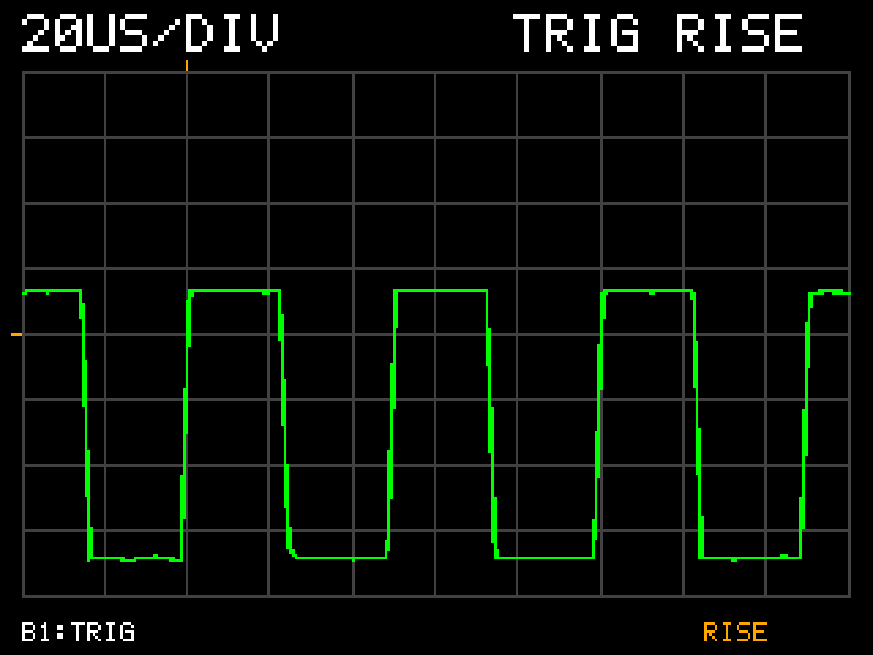

# Oscill — мини-осциллограф на STM32F429I-Discovery

Некоммерческий проект прототипа одноканального цифрового осциллографа на STM32F429I-Discovery
(STM32F429I-DISC1). Прошивка получает выборки встроенного ADC1 по аппаратному
событию TIM2, передаёт их через DMA во внутреннюю SRAM и отображает реальный
сигнал на штатном LCD через LTDC и DMA2D.

Цель проекта — разработка прошивки через агента, сравнение захваченного сигнала с лабораторным генератором и подтверждение результатов измерениями на плате. Правила разработки описаны
в [AGENTS.md](AGENTS.md); журнал проверок ведётся в
[VALIDATION_LOG.md](VALIDATION_LOG.md).

## Текущее состояние

На 13 октября 2026 года быстрый режим **написан, собран, прошит и проверен на
плате MB1075B** на меандре 20 кГц. Время идёт слева направо в логическом
изображении 320×240; кнопка B1 включает простой триггер по переднему фронту.
Оператор подтвердил читаемость уровней/фронтов и повышение стабильности с
триггером. Два framebuffer с переключением во время вертикального гашения
устранили ранее наблюдавшуюся бегущую полосу.

Целевой режим — **20 мкс/дел**, измеренная Fs — **497,05–498,07 квыб/с**;
фактический масштаб — **20,08–20,12 мкс/дел**. За отдельные 65,14 с в TRIG RISE
обработано 31 639 блоков и выведено 985 кадров без зарегистрированных ошибок.
Это демонстрационный результат, а не квалификация точности измерительного прибора.

Проверенная версия прошивки — **`206b98a`**, результаты приёмки сохранены в
Git **`817cc9d`** и [отчёте быстрого режима](FAST_SCOPE_VALIDATION.md).
Ранее, на версии `b29bc2e`, проверены низкие частоты, аппаратный RESET и
power-cycle; эти испытания не выдаются за новые проверки быстрого режима.

## Аппаратная платформа

| Узел | Конфигурация |
|---|---|
| Плата | STM32F429I-Discovery, испытанная ревизия MB1075B |
| MCU | STM32F429ZIT6, Cortex-M4F |
| Тактирование | HSI → PLL; номинальный SYSCLK/HCLK 160 МГц, фактическая частота зависит от HSI |
| LCD | ILI9341, физически 240×320, логически 320×240; RGB через LTDC, настройка панели по SPI5 |
| Внешняя память | SDRAM IS42S16400J, 8 МиБ, FMC Bank2 |
| Framebuffer | Два RGB565-буфера: `0xD0000000` и `0xD0040000`, по 153600 байт, NOLOAD в линкере |
| Вход | PA5 / ADC1 IN5, контакт P2-21 |
| Отладка | Встроенный ST-LINK, SWD |
| HAL tick | TIM6 |
| Эталонные приборы | Hantek DSO2D15 и встроенный генератор, мультиметр Fluke |

USB в текущей прошивке не используется. Часы, FMC/SDRAM и LTDC инициализируются
через HAL/CubeMX; захват ADC/TIM2/DMA2 реализован через регистры и CMSIS.

## Как устроен захват и вывод

```text
TIM2 TRGO → ADC1 IN5 (PA5) → DMA2 Stream0 Channel0
                                   ↓
                       circular buffer, 2048 выборок
                                   ↓ HT / TC
                       очередь событий, короткие ISR
                                   ↓ основной цикл
                       стабильный snapshot, 1024 выборки
                                   ↓ OFF / rising trigger
                        окно 101 выборка, 100 интервалов
                                   ↓ min/max + интерполяция
                   DMA2D: очистка скрытого framebuffer
                                   ↓ CPU, короткими порциями
                        сетка, осциллограмма и подписи
                                   ↓
                   готовый кадр → LTDC reload в blanking → LCD
```

- ADC: 12 бит, выравнивание вправо, один канал. В быстром режиме время выборки
  3 ADCCLK cycles, цель 500 квыб/с; старые диагностические режимы используют 56 циклов.
- TIM2 запускает преобразования аппаратно; запуск ADC из программного цикла отсутствует.
- DMA работает в circular mode с событиями half-transfer и transfer-complete.
- Буфер DMA и snapshot находятся во внутренней SRAM, вне недоступной DMA CCM RAM.
- Проверяются ADC overrun, ошибки DMA, переполнение очереди, устаревание и
  последовательность блоков, защитные слова вокруг буфера и HardFault.
- На LCD чёрный фон, серая сетка и зелёная осциллограмма. Шкала Y фиксирована:
  код 0 внизу, 4095 вверху. Из snapshot выбирается окно 101 выборка — 100
  временных интервалов, отображаемых на 304 столбцах. Min/max сохраняет
  экстремумы, линейная интерполяция заполняет промежутки между выборками,
  но не повышает реальную частоту дискретизации.
- Отрисовка разделена на короткие порции с обслуживанием ADC между ними.
  LTDC читает frontbuffer, пока DMA2D/CPU готовят backbuffer. Готовый кадр
  переключается через vertical blanking reload; старый frontbuffer используется
  для следующего рисунка только после подтверждения завершения reload.
- Период обновления — 67 тиков HAL, около 15 кадров/с в измеренной конфигурации.
  Частота обновления LCD не задаёт частоту ADC.

Динамическая память в рабочих модулях не используется. Отрисовка и расчёт
статистики выполняются вне ISR. Перед включением LTDC выполняется полная
стартовая последовательность SDRAM.

## Отображение и управление

Для чтения изображения повернуть плату на **90° против часовой стрелки**
относительно прежней портретной ориентации. На экране сетка 10×8,
`20US/DIV`, статус триггера и подсказка `B1:TRIG`.

| Режим | Поведение |
|---|---|
| `TRIG OFF` | Режим после запуска; обновление без синхронизации, смещение фазы допустимо |
| `TRIG RISE` | Передний фронт фиксируется под верхней янтарной меткой у второго деления слева |
| `WAIT` | Подходящего фронта нет; последняя форма удерживается, автоматического перехода в OFF нет |

Короткое нажатие **B1/USER** переключает OFF ↔ RISE. Удержание не вызывает
повторного переключения. Уровень фиксирован на коде ADC **2048**, примерно
половине VREF; гистерезис — 32 кода. Перед фронтом сохраняются 20 интервалов,
после него — 80. Меню и ручной настройки уровня нет.

Ниже — считанный с платы framebuffer проверенной версии, **не фотография LCD**:



## Подтверждённые результаты

| Проверка | Результат |
|---|---|
| SDRAM | Расширенные тесты всего объёма 8 МиБ: ошибок данных не зарегистрировано |
| LTDC/DMA2D | Тестовые изображения, примитивы и совместная нагрузка подтверждены |
| Быстрый захват, `206b98a` | ADC1/TIM2/DMA circular; измеренная Fs **497049,6…498073,6 выборки/с** |
| Развёртка | 100 интервалов = **200,77…201,19 мкс** на экран, **20,08…20,12 мкс/дел** |
| Внешний сигнал | Меандр **20 кГц**, Vmin=0,20…0,22 В, Vmax=1,76…1,78 В по Hantek |
| Ориентация/LCD | Время по горизонтали, около четырёх периодов; бегущая полоса исчезла |
| B1/trigger | OFF ↔ RISE; оператор подтвердил улучшение стабильности и передний фронт под янтарной меткой |
| G2 быстрого режима, GND | 30196/30196 блоков, 30920704 обработанные выборки, 941 кадр |
| Отдельный прогон RISE | **65,136 с**, ещё **31639 блоков / 32398336 выборок**, **985 кадров** |
| Ошибки | Зарегистрированные ADC/DMA/DMA2D/LTDC errors, software drops, reload timeout и HardFault — **0** |

Fs измеряется по маркеру **PG13 / P1-29 (LD3)**: один полный период соответствует
2048 выборкам. Измеренные **242,7…243,2 Гц** дают
`Fs = F(PG13) × 2048 = 497049,6…498073,6` выборки/с.
Фактический масштаб равен `10 / Fs` секунд на деление; надпись `20US/DIV`
обозначает целевой режим. При RISE оператор повторно подтвердил PG13 без новых
числовых значений. Это диапазон показаний, не аттестованная погрешность.
Отсутствие ошибок и согласованность счётчиков не доказывают абсолютную
непрерывность каждого отдельного отсчёта при любых условиях.

Контрольные файлы текущей версии: [oscill-fast.elf](diagnostics/task9/oscill-fast.elf),
[SHA256](diagnostics/task9/oscill-fast.sha256), [map](diagnostics/task9/oscill-fast.map).
Raw-буферы, диагностика, скрипты и логи находятся в [diagnostics/task9](diagnostics/task9/).
Сохранены и первичный stale-блок, и однобуферный дефект до исправлений.

Ранее проверено на этапе №8 (`b29bc2e`):

| Проверка | Результат прежней версии |
|---|---|
| Захват | Цифровые тесты 1/10/50/100 квыб/с |
| Fs при цели 100 квыб/с | 99799,04 выборки/с, маркер PG13=48,73 Гц |
| Входные сигналы | DC, синусоиды 100/500 Гц, меандры 100 Гц/1 кГц |
| G2 после power-cycle | 6054 блока / 6199296 обработанных выборок, 941 кадр, зарегистрированные ошибки=0 |
| Перезапуск | RESET и power-cycle подтверждены оператором и чтением диагностики |

Контрольная прежняя прошивка LCD/ADC: Git `b29bc2e`,
[adc-scope.elf](diagnostics/task8/adc-scope.elf).
Итоговые результаты этапа №8 сохранены в Git `15d5910`, raw-буферах, CSV,
JSON и журналах инструментов в [diagnostics/task8](diagnostics/task8/).

## Подключение входа

**PA5 — аналоговый вход, его нельзя считать 5 В-толерантным.** Рабочий
диапазон выбирается по фактическим VDDA/VREF+ и datasheet. Отрицательное
напряжение и превышение допустимого уровня запрещены; входная защитная
схема и аналоговый фронтенд пока не разработаны.

1. Оставить плату включённой, выключить выход генератора и отсоединить сигнал от PA5.
2. Измерить отсоединённый сигнал осциллографом с DC coupling: частоту,
   минимальное и максимальное напряжения, включая выбросы, смещение и полярность.
3. Подтвердить допустимый диапазон и общую землю. В испытании 20 кГц настройки
   генератора были offset +1 В, amplitude 1,5 В; фактически измерено
   Vmin=0,20…0,22 В, Vmax=1,76…1,78 В. Настройки не заменяют измерение выхода.
4. При выключенном выходе соединить GND генератора с GND платы, сигнал — с
   PA5/P2-21; затем включить выход.
5. Перед отключением питания платы выключить генератор и отсоединить сигнал.

Для проверки нулевого входа соединить PA5 с GND при выключенном питании и
отсоединённом генераторе. Последовательный резистор сам по себе не заменяет
защиту от перенапряжения.

## Сборка и режимы

Проект предназначен для STM32CubeIDE; текущая проверенная сборка выполнялась
в STM32CubeIDE 2.2.0 с GNU Tools for STM32 14.3.rel1.

1. Импортировать существующий проект из корня репозитория в STM32CubeIDE.
2. Выбрать конфигурацию `Debug` и выполнить сборку. Результат — `Debug/oscill.elf`.
3. Проверить `.map`: DMA-буфер должен остаться во внутренней SRAM, framebuffer —
   в SDRAM. Адреса объектов SRAM могут изменяться при следующей сборке.
4. Перед записью через ST-LINK подготовить безопасный вход. CubeIDE, OpenOCD и
   CubeProgrammer должны обращаться к ST-LINK по очереди.

В текущем режиме осциллограмма появляется при запуске. Параллельно выполняется
G2 длительностью 63000 тиков HAL; результат сохраняется, после чего захват
перезапускается с теми же настройками и живой вывод продолжается. B1 управляет
только программной синхронизацией отображения, а не запуском преобразований ADC.

Параметры в `Core/Inc/adc_capture.h`:

| Параметр | Назначение |
|---|---|
| `ADC_CAPTURE_DIAGNOSTIC_ENABLE=1` | Захват ADC и осциллограмма, текущий режим |
| `ADC_CAPTURE_DIAGNOSTIC_ENABLE=0` | Предыдущая графическая демонстрация DMA2D |
| `ADC_CAPTURE_TEST_PHASE=1` | Цифровые тесты четырёх частот и статичная нагрузка G1 |
| `ADC_CAPTURE_TEST_PHASE=2` | Отдельный физический захват, по умолчанию 10 квыб/с |
| `ADC_CAPTURE_TEST_PHASE=3` | Быстрый LCD, B1-trigger и совместная нагрузка G2, текущий режим |
| `AC_DISPLAY_RATE_HZ=AC_FAST_RATE_HZ` | Цель 500 квыб/с для живого вывода |
| `AC_FAST_SAMPLE_TIME_CYCLES=3` | Время выборки быстрого режима; требует проверки конкретного источника |

Phase 2 допускает compile-time `ADC_CAPTURE_PHYSICAL_RATE_HZ` для повторов
50/100 квыб/с. Масштаб, окно и фиксированный trigger заданы в
`Core/Inc/scope_view.h`: `SV_TIME_DIV_US=20`, `SV_WINDOW_INTERVALS_SAMPLES=100`,
`SV_TRIGGER_LEVEL_CODE=2048`. Диагностические скрипты в `diagnostics/task8` и
`diagnostics/task9` связаны с конкретными ELF и адресами структур:
перед использованием с новой сборкой сверить символы.
Настройки регистрового захвата задаются исходниками; регенерация из `oscill.ioc`
требует проверки пользовательских модулей и интеграции в сборку.

## Структура и документация

| Файл / каталог | Назначение |
|---|---|
| `oscill.ioc`, `.project`, `.cproject` | CubeMX/CubeIDE проект |
| `Core/Src/main.c` | Тактирование, последовательность запуска и основной цикл |
| `Core/Src/sdram.c` | FMC/SDRAM, стартовая последовательность и диагностика |
| `Core/Src/lcd.c` | Подготовка framebuffer, настройка панели и диагностика LTDC |
| `Core/Src/dma2d_graphics.c` | Графический API DMA2D |
| `Core/Src/dma2d_validation.c` | Проверки и графическая демонстрация |
| `Core/Src/adc_capture.c` | ADC1/TIM2/DMA2, буферы, очередь и статистика |
| `Core/Src/adc_validation.c` | Этапы проверки захвата и совместной нагрузки |
| `Core/Src/scope_view.c` | Поворот, min/max и интерполяция, B1/rising trigger, два буфера |
| `Core/Src/stm32f4xx_it.c` | Обработчики IRQ и диагностика HardFault |
| `Core/Inc`, `Drivers` | Заголовки проекта, HAL и CMSIS |
| `STM32F429ZITX_FLASH.ld`, `STM32F429ZITX_RAM.ld` | Размещение памяти |
| `diagnostics/task8` | Контрольные ELF/map, raw/CSV/JSON, скрипты и журналы |
| `diagnostics/task9` | Быстрый режим: контрольная прошивка, OFF/RISE, непрерывный прогон и считанный кадр |

Подробные результаты:

- [Исходный анализ](ANALYSIS.md).
- [Начальная диагностика SDRAM](SDRAM_DIAGNOSTIC.md) и
  [расширенная проверка SDRAM](SDRAM_EXTENDED_DIAGNOSTIC.md).
- [Запуск LCD/LTDC](LCD_LTDC_INITIAL_DIAGNOSTIC.md).
- [DMA2D и производительность](DMA2D_INITIAL_DIAGNOSTIC.md).
- [ADC/TIM2/DMA и осциллограмма](ADC_CAPTURE_INITIAL_DIAGNOSTIC.md).
- [Быстрый режим, поворот и кнопочный trigger](FAST_SCOPE_VALIDATION.md).

Локальные документы платформы: RM0090, datasheet STM32F429xx и UM1670.
Ссылки на использованные схемы, ревизии и разделы документации приведены в отчётах.

## Ограничения и следующие этапы

Точность измерения напряжения не квалифицирована: зафиксированы смещение и
шум относительно Fluke, принятые для демонстрационного проекта; калибровка
не вводилась. Ранее измеренные 2,970 В на питании SDRAM ниже паспортного
минимума 3,0 В; пройденные функциональные тесты не заменяют квалификацию питания.
Trigger фиксирован на коде 2048: регулируемого уровня, falling trigger и AUTO
нет. Поиск ведётся в одной половине DMA; без подходящего фронта действует
HOLD/WAIT. Окно содержит только 101 реальную выборку; интерполяция не
восстанавливает детали короче периода дискретизации. Короткое время выборки
может давать ошибку при высоком сопротивлении источника.

Проверен меандр 20 кГц, примерно 25 выборок на период. Сигнал 50 кГц,
предельная аналоговая полоса и метрологическая точность **не проверены**.
RESET/power-cycle новой быстрой версии отдельно не повторялись.
Масштаб 20 мкс/дел заменяет прежнее широкое окно: на 20 кГц видны около
четырёх периодов, а не десять периодов 1 кГц из начального задания.

Возможный следующий этап — отдельная сверка частоты, амплитуды и положения
фронтов с Hantek с записью отклонений и условий в журнал.

FFT, несколько каналов, тройное чередование ADC, регулируемая развёртка,
аналоговый усилитель/делитель, сенсорное управление и полноценный интерфейс
в текущую реализацию не входят.
